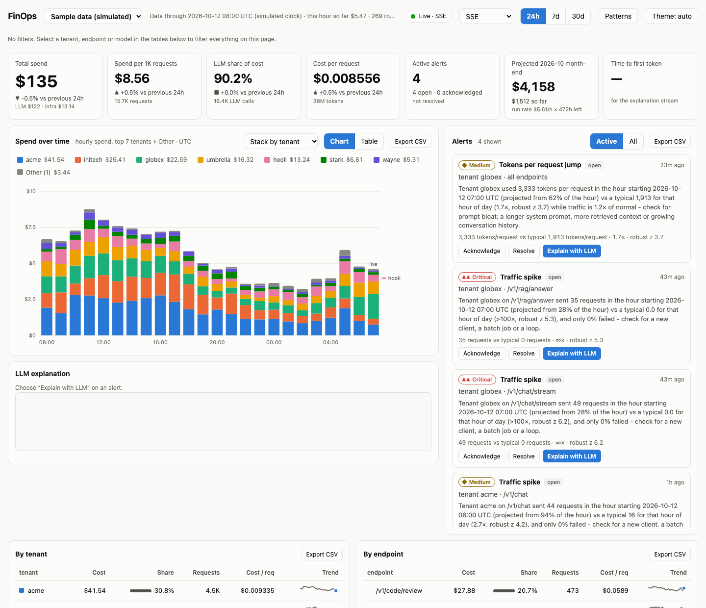
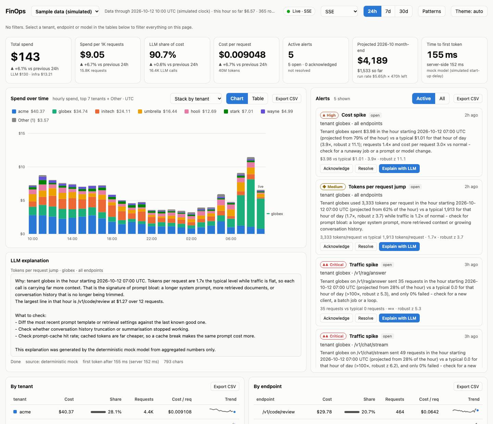
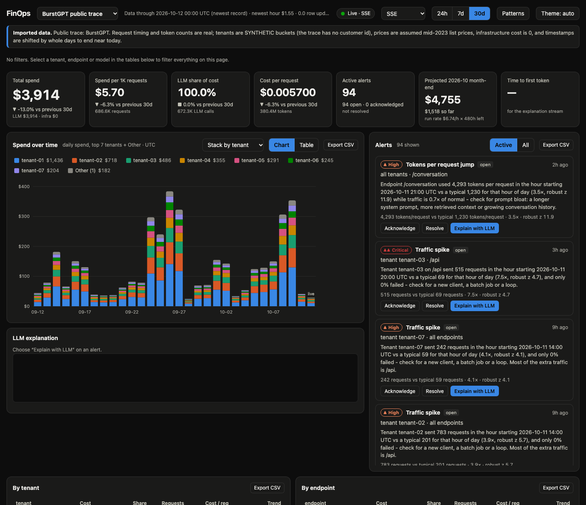

# FinOps Dashboard

[](https://github.com/rushabh05/finops-dashboard/actions/workflows/test.yml)
[](LICENSE)
[](#quick-start)
[](package.json)

A real-time dashboard showing where LLM and infrastructure money goes, **per tenant, per endpoint and per LLM call**. It streams cost
updates and alerts to the browser with real backpressure, detects cost anomalies with explainable statistics (no ML), and can stream an
LLM-written explanation of any anomaly into a side panel. It can also import **your own Claude Code usage** and **public LLM traffic traces**,
and a built-in **data source switcher** moves between the simulated sample and any imported database.



<table>
<tr>
<td width="50%"></td>
<td width="50%"></td>
</tr>
<tr>
<td><sub>Press <b>Explain with LLM</b> on an alert: the text streams in (here the built-in deterministic mock; set <code>ANTHROPIC_API_KEY</code> for Claude).</sub></td>
<td><sub>Dark mode on 1.43M real requests (<a href="https://github.com/HPMLL/BurstGPT">BurstGPT</a>); the banner says what is real and what is assumed. The <b>Data source</b> menu is top left.</sub></td>
</tr>
</table>

**Zero npm dependencies.** Node's built-in `node:http`, `node:sqlite`, `node:crypto`, `node:test`; the WebSocket handshake and framing are
hand-written (`src/ws.js`). The client is one HTML page, vanilla JS modules and inline SVG, with light and dark themes, a colour-blind-safe
palette and keyboard/screen-reader support.

## Quick start

Requires **Node >= 22.13** (`node:sqlite` without a flag). No `npm install` is needed.

```
git clone https://github.com/rushabh05/finops-dashboard.git && cd finops-dashboard
npm start                    # http://127.0.0.1:8787  (first run seeds 30 days of simulated history in ~3 s)
npm test                     # 148 tests, ~12 s
```

Open the page and wait a few seconds: the simulator writes live traffic and plants three anomalies (a tenant cost spike, prompt bloat,
a retry storm). Alerts appear in the right column; press **Explain with LLM**. The **Backpressure lab** at the bottom lets you slow the link,
speed up the model and flood the write path and watch the stream cope.

Use it on real data:

```
npm run import:claude-code   # your own Claude Code usage            -> data/claude-code.db
npm run import:trace -- data/datasets/burstgpt-v2.0/BurstGPT_1.csv   # a real public trace -> data/burstgpt.db
npm start                    # the "Data source" menu (top left) now lists them: pick one
```

### Data sources and the switcher

`npm start` serves **every dashboard database in `data/`** from one server: the simulated sample (`data/finops.db`, created on first run) plus anything
the importers built. The page has a **Data source** menu; picking one opens that database's dashboard at `/d/<name>/` (so Back and Forward, bookmarks and
separate tabs work), each with its own data, live stream, alerts and banner. Databases are opened on first use and rescanned every few seconds, so one you
import while the server runs appears without a restart. Imported databases are real data and never get simulated rows; the sample's simulator **pauses while nobody is
watching it** so an unattended server does not grow it forever.

| You run | You get |
|---|---|
| `npm start` | multi-database mode over `data/` (`DATA_DIR=...` to point elsewhere; `DEFAULT_SOURCE=claude-code` to choose what `/` opens) |
| `DB_PATH=data/claude-code.db npm start` | exactly that one database at `/`, no menu (the original single-database mode, also what the tests use) |
| `PORT=8788 npm start` | another port, e.g. beside a server that is already running |

Requires Node >= 22.13 (`node:sqlite` without a flag). The test suite passes on Node 22.13.0, 22.23 and 24 on Linux and on Node 24 on macOS (see
[What is verified](#what-is-verified-and-what-is-not)). Binds to `127.0.0.1` and, by default, has no authentication: set `AUTH_TOKEN` before exposing it
(see [Security](#security)).

> **Not affiliated with, or endorsed by, Anthropic, OpenAI or Microsoft.** Model names and prices are used descriptively. Prices in `src/import/prices.js` were
> written down on 2026-10-12 from the sources named there and **will go out of date**: check them before relying on a dollar figure.

**Other commands:** `npm run check:llm` (live check of the Anthropic explanation source, needs a key), `npm run eval:real -- data/burstgpt.db` (what the detector does on real data), `npm run seed` (seed the DB without serving), `node --disable-warning=ExperimentalWarning scripts/eval-detector.js`
(multi-seed detector evaluation), `node --disable-warning=ExperimentalWarning scripts/ui-smoke.mjs` (optional headless-Chrome UI smoke test) and
`scripts/ui-smoke-imported.mjs <db>` (the same for an imported database), `scripts/ui-smoke-switcher.mjs` (drives the data source switcher) and `scripts/screenshots.mjs` (regenerates `docs/images/`).

## Layout

```
src/
  config.js      all settings + env vars          db.js         schema, triggers, change log, transactions
  pricing.js     cost formula + price book        ingest.js     validation, cost, raw rows + rollups in one tx
  sim.js         seeded traffic generator         detector.js   robust-z anomaly detection
  alerts.js      alert queries, ack/resolve       explain.js    aggregate-only context, mock + Anthropic sources
  feed.js        change log -> per-entity rows    channel.js    THE streaming layer (row lane, token lane, write loop)
  transport.js   byte sinks + slow-link simulator hub.js        channel registry, fan-out, throttle, stats
  ws.js          RFC 6455 handshake + frames      queries.js    REST queries, CSV export
  security.js    allowlists, body caps, origin    server.js     routes, SSE + WS endpoints, app wiring
  multi.js       multi-database front door: discovers data/*.db, routes /d/<id>/..., the source switcher's list
  import/        claude-code.js (transcripts -> requests), traces.js (BurstGPT / Azure CSV -> requests),
                 prices.js (real dated price lists), common.js (protected import DB, batch writer, detector backfill)
public/          index.html, style.css, app.js, charts.js, stream.js, dom.js, format.js
docs/images/     README screenshots (simulated and public data only)
tests/           node:test suites (+ helpers.js: fake transport, SSE/WS clients, mirror of the browser state)
scripts/         seed.js, eval-detector.js, eval-detector-real.js, import-claude-code.js, import-trace.js, check-anthropic.js,
                 ui-smoke.mjs, ui-smoke-imported.mjs, ui-smoke-switcher.mjs, screenshots.mjs
                 (+ cdp.mjs, a tiny DevTools-protocol driver)
data/            finops.db (simulator), claude-code.db / burstgpt.db / azure-*.db (imports), datasets/ (downloaded CSVs); all git-ignored
```

## Data and cost formulas

SQLite, money stored as **integer micro-dollars** (1 USD = 1,000,000). Tables: `requests`, `llm_calls`,
`model_prices`, `rollups_hourly`, `alerts`, `changes` (+ a small `meta` table). Triggers on `rollups_hourly` and
`alerts` append `(table, row_id, op)` to `changes` (`seq` is `AUTOINCREMENT`, so a seq is never reused); that log is
what the live feed follows.

**LLM cost is always computed from `model_prices`, never hard-coded** (`src/pricing.js`). Prices are micro-USD per
million tokens (so $3.00/Mtok = `3000000`). `input_tokens` is the *whole prompt*: it includes `cached_tokens` (served from the
prompt cache, billed at the cache-read rate) and the tokens *written* to the cache, which are billed at their own rates
(`cache_write_tokens` = 5-minute TTL, `cache_write_1h_tokens` = 1-hour TTL; Anthropic charges 1.25x and 2x the input price):

```
uncached_in = input_tokens - cached_tokens - cache_write_tokens - cache_write_1h_tokens
cost_micro  = round_half_up( (uncached_in * input_per_mtok
                              + cached_tokens * cached_per_mtok
                              + cache_write_tokens * cache_write_per_mtok
                              + cache_write_1h_tokens * cache_write_1h_per_mtok
                              + output_tokens * output_per_mtok) / 1_000_000 )
```

The two cache-write fields are optional and default to 0, so existing clients and databases are unaffected (`openDb` adds the four new
columns to an older database with `ALTER TABLE ... ADD COLUMN`). Ingest refuses a call that writes to the cache for a model whose price row
has no write rate, rather than billing those tokens at zero.

All of it is integer arithmetic until the single final rounding (checked against a `BigInt` reference in the tests).
The price used is the latest row with `effective_from <= call ts`. The default prices seeded for the **simulator** are
**illustrative** list prices for three models (`claude-haiku-5-5`, `claude-sonnet-5-5`, `claude-opus-5-5`). Imported databases
get a real, sourced price list instead (`src/import/prices.js`, see below). Edit the table and the next ingest uses it.

Infrastructure cost is **supplied by the client** (`infra_cost_micro_usd` on each request) and is not derived from
prices. Request total = infra + sum of its LLM calls.

### Rollups

`rollups_hourly` has grain `(hour, tenant_id, endpoint, model)`:

* `model = ''` is the **infra row**: it carries `requests` and the infra cost of those requests.
* `model = 'x'` is an **LLM row**: it carries `llm_calls`, `tokens_in`, `tokens_out` and the LLM cost of calls to `x`.

So for any slice, `SUM(requests)` is the request count, `SUM(cost_micro_usd)` is total cost and
`SUM(cost) WHERE model <> ''` is LLM cost. One consequence: when a **model filter** is active, requests are not
attributable to a model, so per-request tiles show "—" instead of a wrong number. The rollup for a call is keyed by the
call's own `ts` hour. Ingest is idempotent per request id (a re-sent request is skipped, with its calls and rollup
contribution). `GET /api/stats?verify=1` recomputes every rollup from the raw tables and compares.

### Dashboard metrics

| Tile | Formula |
|---|---|
| Total spend | `SUM(cost)` over the range (infra + LLM) |
| Spend per 1K requests | `total cost / requests * 1000` |
| LLM share of cost | `LLM cost / total cost` |
| Cost per request | `total cost / requests` |
| Active alerts | alerts whose status is not `resolved` (live from the stream) |
| Projected month-end | `month-to-date + trailing-7-day average hourly cost * hours left in the UTC month` |
| Time to first token | client-measured time from pressing **Explain** to the first token event (server-side time shown beside it) |

Ranges are 24h / 7d / 30d **relative to the newest data hour**, not the wall clock (the simulated clock can run ahead
of it). Chart buckets are 1h / 6h / 24h. Each delta compares with the immediately preceding window of the same length.

## Ingest and simulation

`POST /api/ingest` takes `{ "requests": [ { id, ts, tenant_id, endpoint, method, status, duration_ms,
infra_cost_micro_usd, llm_calls: [ { model, input_tokens, output_tokens, cached_tokens?, cache_write_tokens?, cache_write_1h_tokens?, latency_ms, ts?, id? } ] } ] }`.
It validates every field (types, ranges, regexes, known model with a price at that `ts`, `cached + writes <= input`, unknown
fields rejected), computes cost, and writes raw rows plus rollups in **one transaction**. A batch is capped at 1000
requests (413) and 1 MB; any invalid item rejects the whole batch (400 with a list), so a retry can never half-apply.

The simulator (`src/sim.js`) is seeded: 8 tenants, 12 endpoints, 3 models, daily seasonality (per-tenant phase),
Poisson counts with per-hour traffic shocks. It writes **through the same ingest path**. Its write rate is adjustable at
runtime (`POST /api/sim {rate}`): `rate` is requests written per real second, and the simulated clock advances by the
amount of simulated time that many requests represent, so a higher rate also means a faster clock. Three anomalies are
injected, on a schedule or on demand (`{inject: ...}`): `tenant_cost_spike` (one tenant: 1.8x requests, 2.5x tokens),
`token_bloat` (one endpoint: tokens per request x3, traffic flat), `retry_storm` (one tenant+endpoint: 8x requests,
80% fail with 429/5xx, failed attempts still sometimes call the model).

## Importing real data

The dashboard needs a source of requests. Besides the simulator and `POST /api/ingest` there are two importers. Both write
**straight into a SQLite file through the same `Ingestor`** the HTTP route uses (validation, cost from `model_prices`, raw rows + rollups in one
transaction per batch), so the HTTP body and batch caps do not apply but every other rule does. Run them with the server stopped (or on another file).

| Database (built by) | What it holds | Size / time |
|---|---|---|
| `data/claude-code.db` (`npm run import:claude-code`) | your own Claude Code usage: ~47K API responses, ~3.3K prompts and sub-agent runs, Aug 12 to Oct 12 | 12 MB, 5 s |
| `data/burstgpt.db` (`npm run import:trace -- .../BurstGPT_1.csv`) | [BurstGPT](https://github.com/HPMLL/BurstGPT) (CC BY 4.0): 1.43M real Azure OpenAI requests over 61 days | 376 MB, 13 s |
| `data/azure-conv.db`, `data/azure-code.db` | [Azure LLM inference trace 2023](https://github.com/Azure/AzurePublicDataset) (CC BY 4.0): one hour of a conversation / a code service | 6 / 2.5 MB, <1 s |

View them with `npm start` and the **Data source** menu (or `DB_PATH=data/claude-code.db npm start` for one database on its own). The importers **tag** the database (`meta.source`, `meta.source_note`): the page shows the note in a
banner ("Imported data. ...") and the footer says the newest record defines "now", `/api/stats` reports `source`, and the **simulator is disabled** on that
file (`POST /api/sim` answers 409, nothing is seeded or simulated) so real rows can never be mixed with simulated ones. An importer will not overwrite
a database that holds data and was not created by an importer (e.g. the simulator's `data/finops.db`); `--replace` rebuilds one of its own.

### Claude Code usage (`scripts/import-claude-code.js`)

Claude Code appends every message to `~/.claude/projects/<project>/<session>.jsonl` and sub-agent runs to `<session>/subagents/agent-*.jsonl`. Only usage
metadata is read (model, token counts, timestamps, project folder, agent type, the API-error flag): **message text is never copied out**, and a test fails
if a canary string from a prompt, an answer or a tool result reaches the database. Full paths are not stored either, only a folder-name label.

| Dashboard | Claude Code |
|---|---|
| tenant | the project folder (a git worktree folds into its project; two projects with the same folder name become `name-<first differing ancestor>`) |
| request | one user prompt (the main agent's whole turn) or one sub-agent run; status 429/5xx when an API-error entry belongs to it, else 200 |
| endpoint | `/main/<cli\|vscode\|desktop\|...>` for the main agent, `/agent/<general-purpose\|explore\|workflow-subagent\|...>` for sub-agents |
| LLM call | one API response; `input_tokens` = input + cache reads + cache writes, `cache_write_*` split by TTL, `output_tokens` includes thinking; `latency_ms` = from the prompt or tool result it answers to the end of the response |
| cost | tokens x `model_prices`: the **API-equivalent list price**. On a flat-rate plan this is what the tokens would cost on the API, **not what you pay**. Infrastructure cost is 0. |

Things that would silently double or distort the numbers, all measured on real history and handled: one API response is written as **several JSONL lines**
(one per content block, usage repeated, early lines holding a partial `output_tokens`; 56,900 of 108,111 lines here), so a response counts once, with the line
that has the final output count; the same response also appears in several files (forks and resumes, 4,122 lines), so it counts once, in the oldest file;
`<synthetic>` entries are client-side API errors with no tokens. Responses from a model with no price are skipped and reported (`--price MODEL=in,out,read,write5m,write1h`).

**Price check.** Claude Code records its own per-session, per-model token totals and `costUSD` (`cost-state` entries). Its counter covers only part of a
session after a resume, fork or sub-agent run, so most pairs are not comparable, but where the four token totals match **exactly** the dollars can be compared:
on 11 session x model pairs (fable-5-1, opus-5-5, sonnet-5, sonnet-5-5) this import computes **$87.386967 against Claude Code's $87.386962** (worst pair off by 0.0005%).
That validates the de-duplication rule and the rates, including the 1.25x / 2x cache-write multipliers. `opus-5`, `haiku-4-5` and `haiku-5-5` have no exact pair and are priced from the
catalog / list price without a cross-check. The importer prints this check on every run.

Limits: usage that is not in the local files cannot be imported (the dashboard total can therefore be *lower* than Claude Code's own counter for a session whose
transcripts were removed, and *higher* than `/cost` where that counter missed sub-agent usage); claude.ai chat in the browser is not recorded locally; web-search fees and
fast-mode surcharges are not priced (counted and warned about); Windows-style paths are not handled; Haiku 5.5's higher tier above 100K-token prompts is not modelled.
Options: `--days N` / `--since YYYY-MM-DD`, `--root DIR`, `--db FILE`, `--replace`, `--detect-days N`, `--price ...`.

### Public traces (`scripts/import-trace.js`)

Supported: BurstGPT (both file layouts: with and without `Session ID` / `Elapsed time`) and the Azure LLM inference traces (2023 and 2024 layouts), detected from the header. Download
the CSV into its own directory first (`data/datasets/<name>/`, git-ignored); the importer takes the path as an argument and never executes anything from it.

What is **real**: request timing (bursts, daily and weekly rhythm), token counts, the API surface (`/api` vs `/conversation`, `/code` vs `/conversation`), failures (BurstGPT marks them
with 0 response tokens: 25,443 of 1,429,737, exactly the count its documentation gives; recorded as status 500, no LLM call, no cost).
What is **assumed** (and stated in the banner): the traces have no customer, so tenants are **synthetic** buckets (`--tenants 8 --skew 1`: shares follow 1/k, assigned by a seeded hash;
a BurstGPT `Session ID`, when present, keeps a conversation on one tenant); prices are a price table (BurstGPT: assumed mid-2023 list prices, `gpt-3.5-turbo` $1.50/$2.00 and `gpt-4` $30/$60 per Mtok; Azure
traces name no model, so every call is priced as `--model`, default `claude-sonnet-5-5`; `--model-map ChatGPT=claude-haiku-5-5,GPT-4=claude-sonnet-5-5` re-prices BurstGPT on another list);
infrastructure cost is 0; cached tokens are 0. Timestamps are shifted by **whole days** so the trace ends within a day of now (`--end now|keep|ISO`), which keeps hour-of-day and weekday phase.
Options: `--sample P` (deterministic thinning, volumes scale by P), `--days N` (keep the newest N days), `--format`, `--service`, `--seed`, `--price`, `--detect-days`.
The 2024 week-long traces are 0.7 GB (code) and 1.1 GB (conversation); they use the same layout, so `--sample 0.05` on them is the way to try them (not downloaded or tested here).

### What the detector does on real traffic

The simulator's noise model was used to tune the detector (0 false positives in 2,226 normal-hour evaluations). BurstGPT is the first real traffic it has seen. Reproduce the numbers below with
`npm run eval:real -- data/burstgpt.db` (it works on a temporary copy). Over the last 53 days of the trace (no tuning, no labels): **494 alerts, about 9 a day** (242 volume spikes, 113 cost spikes, 78 cost-per-request,
57 tokens-per-request, 4 retry storms), on all 53 days.
They are not marginal: the median is 7.2x the same-hour baseline, the median robust z is between 5.6 and 7.4 depending on the kind (the threshold is 4), and only 3% are under 2x. Over half (280) are on `/api`, whose hourly volume is extremely bursty
(over its 828 hours with any traffic: median 592 requests/hour, p99 14,655, max 33,236), and 27% have a near-zero baseline. With no ground truth I cannot say how many are *incidents*; what I can say is that the traffic really does
contain bursts of about 10 to 18x the same hour on earlier days, that the weekday baseline ("same hour, previous 7 days") is not modelled, and that for bursty traffic of this kind about 9 alerts a day is
what these thresholds produce. I did not tune them on unlabelled data (that would fit noise); this is the first thing to review with real operators. On the Claude Code data (`npm run eval:real -- data/claude-code.db`) it raises 22 volume alerts in 53 days, every one on a baseline of zero: activity where there was none, which for personal usage means "a busy hour".
Scale check on `burstgpt.db` (1.43M requests): every rollup-backed REST endpoint answers in <= 70 ms, the "most expensive requests over 30 days" drill-down in 0.47 s.

## Anomaly detection (explainable, no ML)

For an entity (a **tenant**, an **endpoint**, or a **tenant x endpoint pair**) and the latest hour `H`:

```
baseline samples = the metric at H-1d, H-2d, ... H-Nd          (same hour-of-day, N = 7 days)
baseline         = median(samples)
sigma            = max( 1.4826 * MAD(samples),                 robust spread
                        0.12 * baseline,                       relative floor
                        cv / sqrt(baseline_requests) * baseline )   noise expected at this volume
z                = (observed - baseline) / sigma               robust z-score
```

`cv` is an assumed per-request coefficient of variation (requests 1.0, cost 3.0, cost/request 3.0, tokens/request 2.0;
cost is heavy-tailed because an Opus code review costs ~100x a classifier call). For request **counts** the z is also
computed in variance-stabilised space, `2*sqrt(f)*(sqrt(obs)-sqrt(base))/1.2`, and the smaller of the two is used
(a Poisson count is skewed, so the linear z over-fires on small baselines).

An alert needs `z >= 4` **and** `observed/baseline` above a per-metric minimum (cost 1.5x, volume 2x, tokens/request
1.4x, cost/request 1.4x), plus guards that exist to avoid noise:

* **minimum volume**: >= 30 requests in the (projected) hour and >= 10 actually observed;
* **minimum absolute cost**: >= $0.25/hour for the cost-based kinds (volume spikes are judged on volume alone);
* **history**: at least 4 of the 7 baseline days must exist, otherwise the detector stays silent;
* only increases alert.

**Metrics and kind.** Cost, requests, tokens per request and cost per request are all checked. Cost = requests x cost
per request, so the kind is chosen by decomposing the move: traffic roughly flat and tokens/request up => `tokens_per_request`
(prompt bloat); flat traffic and cost/request up => `cost_per_request`; requests >= 2x with per-request cost normal
=> `volume_spike`, relabelled `retry_storm` when >= 30% of that entity's requests in the hour were 429/5xx (read from the
raw `requests` table); otherwise `cost_spike`.

**Partial hours.** The detector's "now" is the newest data timestamp. If at least 25% of the current hour has elapsed it
is judged by projecting counts and cost to a full hour (noise is then judged on `f * baseline_requests`, since a partial
hour carries less evidence); before that, the previous complete hour is judged.

**No pile-ups.** If one flagged endpoint accounts for >= 60% of a flagged tenant's excess (or vice versa) the dependent
alert is dropped and mentioned in the explaining alert ("also accounts for the rise on ..."); when two entities explain each
other (a single hot pair) both are kept. Pair-level volume checks are skipped when the pair's tenant or endpoint
already has an alert.

**Alerts.** Each stores `observed`, `baseline`, `score` (the robust z of the primary metric) and a one-line plain-English
explanation, plus the evaluated `hour` and a JSON `detail` with all four metrics (two columns beyond the spec). Alerts are
**deduplicated per (kind, tenant, endpoint) inside a 3-hour cooldown** (data time, regardless of status). Status is
`open -> ack -> resolved` (resolve is allowed straight from open; a resolved alert cannot be acknowledged). Severity is
derived, not stored: `critical` if z >= 15 or ratio >= 5, `high` if z >= 8 or ratio >= 3, else `medium`.

`scripts/eval-detector.js` evaluates 14 seeds x 7 days of hourly evaluations with the three anomalies injected: **no alert
outside an injected window in any seed (0 false positives in 2,226 normal-hour evaluations), every anomaly found in every seed**,
and 3 extra alerts inside injected windows (e.g. a small tenant's cost during the token-bloat hours).

## Streaming layer

One `Channel` object per client, over SSE or WebSocket **behind the same interface**: the channel produces events
`{event, id?, data}`; a *codec* frames them (`sseCodec`: `id:/event:/data:`; `wsCodec`: one JSON text frame), and a *transport*
is a byte sink with a `buffered` counter and a `'drain'` event. A slow-link simulator (`LinkSim`, a token bucket) sits
between codec and socket, so the same code path is exercised by the real server and by tests.

```
 changes table (triggers) --> ChangeFeed --entries--> Channel.pushRows --> pending Map (one entry per entity)
                                                                                |
 LLM source (async iterator) --> Channel._runSource --> token queue             |   write loop (pump):
        ^   not pulled while tokenBytes >= highWater      |                     |   while transport.buffered < bufferLimit
        +-------------- resumed at <= lowWater -----------+                     |     pick a lane -> encode -> transport.write
                                                                                v   stop; resume on transport 'drain'
                                   codec (SSE | WS) --> LinkSim (throttle) --> NodeTransport (res / socket)
```

### Row lane: conflation, snapshots, resume ids

* The feed turns change-log rows into **one entry per entity** (`r:<rollup rowid>`, `a:<alert id>`) carrying the *current* row
  and the entity's newest `seq`. In each channel, `pending` is a `Map` keyed by entity: a newer value replaces the pending one
  (**latest wins**, counted as `rows_conflated`) and moves to the back, so iteration order is ascending by newest seq.
* If `pending.size > maxPending` (600) the set is **dropped** and the channel owes a `snapshot` (`resyncs++`). While a snapshot
  is owed, incoming rows are ignored (the snapshot, read at send time, reflects them). The snapshot is the whole live window
  (last 6 hours of rollups, columnar) plus the 200 newest alerts.
* **Frame ids.** Every `rows`/`snapshot` frame carries `id` = the newest change-log seq *fully delivered*. If a frame takes
  every pending entry, its id is the feed head the channel has seen; if it takes only a prefix (at most 100 rows per frame),
  its id is the seq of its last row, which is correct because no remaining entry is older. Token frames carry **no** `id`, so
  they never move `Last-Event-ID`.
* **Resume.** The browser's `EventSource` reconnects with `Last-Event-ID`; WebSocket clients pass `?lastEventId=`. The server
  replays the changes after that cursor (collapsed per entity, restricted to the live window). It falls back to a snapshot when
  the log was pruned past the cursor (`changes_pruned_to`), the cursor is newer than the log head, or more than `maxPending`
  entities changed. Correctness is tested as a property: 150 random trials with writes, partial flushes, **frames lost in
  flight**, pruning and reconnects must converge to the DB, both via incremental resume and via snapshot fallback.

### Token lane: ordered, lossless, pausable

* Chunks are queued in order. While the client keeps up, each chunk is its own frame; while it is slow, **adjacent chunks of
  the same generation are merged** into one frame (up to 2 KB), counted as `chunks_coalesced`. Frames carry a running offset
  `o`, so the client (and the tests) verify nothing was lost or reordered.
* Above the **high-water mark** (16 KB queued) the source is **not pulled** (`model_pauses++`); it resumes below the low-water
  mark (4 KB). Because the source is an async iterator, "pausing" is simply not calling `next()`: the mock stops producing, and
  the Anthropic source stops reading its HTTP body, so TCP flow control pushes back upstream (at most one read-ahead is buffered).
* One generation per channel; starting another cancels the first. Cancel/close aborts the upstream request and drops queued
  chunks; an ordered `gen_end` (`done | cancelled | error`) is always sent.

### The write loop

The loop writes only while `transport.buffered < bufferLimit` (32 KB) and otherwise waits for the transport's `'drain'` event
(emitted when `buffered` falls to `drainMark`, 8 KB). `buffered` is tracked through per-write callbacks, so it is also correct for the
simulated slow link and does not depend on Node's own high-water-mark semantics. **Tokens have priority, but rows are owed about a
third of the bytes while a token backlog exists**: when both lanes are backlogged a row frame is sent whenever
`row_bytes < token_bytes * share / (1 - share)` (share = 1/3), else a token frame; the counters reset when the token backlog
empties. Neither lane can starve the other. A consumer that stays blocked for 2 minutes is evicted; idle channels get a heartbeat
(`: hb` / WS ping) every 15 s and sockets use TCP keep-alive.

### Endpoints

`GET /stream?cid=` (SSE), `GET /ws?cid=` (WebSocket), `POST /api/generate {cid, alert_id, source?, tokens_per_sec?, repeat?}`,
`POST /api/cancel {cid}`, `POST /api/throttle {cid?, bytes_per_sec}` (0 = unlimited; no `cid` = all channels and new ones),
`POST /api/sim {rate?, running?, inject?, hours?}`, `GET /api/stats[?cid=&verify=1]` (channel counters, queue depths, sim,
detector, DB, change-log state), `GET /healthz`. Events: `hello`, `snapshot`, `rows`, `token`, `gen_start`, `gen_end`.

### Explanations

`/api/generate` builds a context from **aggregates and entity names only** (the alert, 12 hours of hourly totals, the same hour
on previous days, a top-5 breakdown, the model mix; never request ids or rows) and streams from:

* a **deterministic mock** (default): same alert, same text; word-sized chunks at `tokens_per_sec` after a simulated ~150 ms
  start-up delay. `repeat` (1-100) repeats the text, as a stress option for the lab;
* **Anthropic** when `ANTHROPIC_API_KEY` is set: raw HTTP `POST {ANTHROPIC_BASE_URL}/v1/messages` with `stream: true`, SSE parsed by
  hand, `claude-sonnet-5-5` by default (`ANTHROPIC_MODEL`), `x-api-key` and `anthropic-version: 2023-06-01`, `max_tokens` 700, no
  sampling parameters, and `output_config.effort: "low"` to keep the first token quick (`ANTHROPIC_EFFORT=` empty omits it).
  Errors (HTTP or in-stream) end the generation with `reason: "error"`; the key is never echoed.

## REST

`GET /api/summary`, `/api/by-tenant`, `/api/by-endpoint`, `/api/by-model`, `/api/timeseries?group=tenant|endpoint|model|total&range=&top=`,
`/api/requests/:id` (with its LLM calls and the price used), `/api/alerts`, `POST /api/alerts/:id/ack|resolve`,
`GET /api/export.csv?view=tenant|endpoint|model|timeseries|alerts|requests` (the current range and filters). Filters are
`range=24h|7d|30d&tenant=&endpoint=&model=`. Additions beyond the spec: `GET /api/requests?sort=cost|recent&limit=` (the drill-down list)
and `/api/stats`. The per-dimension tables ignore their *own* dimension's filter so a selected row stays visible among its siblings
(cross-filtering); everything else applies all filters.

## UI

Tiles, a stacked spend chart (top 7 + Other, legend, direct labels where they fit, hover/keyboard tooltip listing every series,
table view), tenant/endpoint/model tables (cost, share, requests, cost per request, sparkline; click to filter everything), request
drill-down with each LLM call (tokens, cached tokens, latency, cost), alerts (severity, explanation, ack, resolve, Explain with LLM),
the LLM explanation panel, and the backpressure lab (link speed, model speed, write rate, explanation length; counters for chunks
coalesced, model pauses, rows conflated, resyncs; a queue sparkline). Colours come from a validated colour-blind-safe categorical
palette with separately stepped dark values; an entity keeps its colour whatever else is on screen; severity is always icon + text; an
opt-in **Patterns** toggle adds 45/135-degree hatching; `prefers-reduced-motion` turns animations off; all tenant-supplied strings
go through `textContent` (a test fails if any `innerHTML`-style API appears in the client).

How "live" works: the stream carries rollup rows and alerts. The browser keeps the live window (last 6 h) and the alerts in local state
(the alert panel and the "this hour so far" figure come straight from it). Charts, tables and tiles are recomputed by the server and
re-fetched at most every 1.2 s after row frames arrive, so every view uses the same query code and filters.

## Security

Parameterized SQL only (the only interpolated identifiers are fixed column names chosen from a constant map). Every query parameter is
validated against an allowlist (enums, integer ranges, regexes) and unknown or repeated parameters are rejected. JSON bodies are capped
(1 MB for ingest, 8 KB elsewhere, also enforced while streaming without `Content-Length`) and `Content-Type: application/json` is required on
every POST (415). **Origin** is checked on every POST and on the WebSocket upgrade: allowed are the loopback origins for the served port plus
`ALLOWED_ORIGINS`; a *missing* Origin (curl, scripts) is allowed unless `STRICT_ORIGIN=1`, because browsers always send one. The **Host**
header must also be one we serve (DNS-rebinding guard; add names with `ALLOWED_HOSTS`). A CSP forbids inline script/style and `eval`
(`default-src 'none'; script-src 'self'; style-src 'self'; connect-src 'self' ws://<host>` ...), plus `nosniff`, `no-referrer`,
`frame-ancestors 'none'`. Client ids must match `^[A-Za-z0-9_-]{8,64}$`; channels are capped (64) as are concurrent generations (4); WebSocket
frames from clients are capped (64 KB) and must be masked. CSV exports neutralise spreadsheet formulas. Static files come from an allowlist built
at startup (no path traversal). The model is only ever sent aggregates.

**Authentication (optional).** Set `AUTH_TOKEN` (at least 16 characters; it is checked before anything is opened). Every request except `/healthz` then needs either
`Authorization: Bearer <token>` (scripts, `curl`) or the session cookie that visiting `/?token=<token>` sets once per browser: the server answers 303 to the same URL
*without* the token, so the secret does not stay in the address bar. The cookie holds an HMAC derived from the token (never the token), is `HttpOnly` and `SameSite=Strict`
(add `Secure` with `COOKIE_SECURE=1` behind HTTPS) and is sent by `EventSource` and the WebSocket upgrade too; together with the Origin check on POST this covers CSRF.
Comparisons are constant-time. Without a token the server **refuses to listen on a non-loopback `HOST`** (`ALLOW_INSECURE=1` overrides, for use behind a proxy that authenticates).
The token travels in the clear unless you terminate HTTPS in front, and a first visit with `?token=` puts it in that one request's URL (and so in any proxy log): for anything beyond
a trusted network use HTTPS and prefer the Bearer header. There is a single shared secret: no users, roles, rate limiting or lockout.

## Configuration

| Env | Default | |
|---|---|---|
| `HOST` / `PORT` | `127.0.0.1` / `8787` | |
| `DB_PATH` | unset | set: serve exactly this database at `/` (single-database mode; `:memory:` works). Unset: multi-database mode over `DATA_DIR` |
| `DATA_DIR`, `DEFAULT_SOURCE` | `data/`, the sample | multi-database mode: where the databases are, and which one `/` opens |
| `SEED_DAYS`, `SEED_VOLUME`, `SIM_SEED` | `30`, `1`, `42` | history length, volume multiplier, RNG seed |
| `SIM_RATE`, `SIM_AUTOSTART`, `SIM_ANOMALIES` | `40`, on, on | requests/s; set `0` to disable |
| `SIM_PAUSE_WHEN_IDLE`, `SIM_IDLE_MS` | on in multi-database mode, `30000` | stop simulating while nobody is watching the sample (`SIM_PAUSE_WHEN_IDLE=0` keeps it running) |
| `ANTHROPIC_API_KEY`, `ANTHROPIC_MODEL`, `ANTHROPIC_BASE_URL`, `ANTHROPIC_EFFORT`, `ANTHROPIC_MAX_TOKENS` | -, `claude-sonnet-5-5`, api.anthropic.com, `low`, `1500` | effort `''` omits `output_config`; max tokens includes thinking tokens |
| `ALLOWED_ORIGINS`, `ALLOWED_HOSTS`, `STRICT_ORIGIN` | -, -, off | comma-separated lists |
| `AUTH_TOKEN`, `COOKIE_SECURE`, `ALLOW_INSECURE` | -, off, off | shared-secret auth (>= 16 chars); `Secure` cookie flag; allow a non-loopback `HOST` without a token |
| `LIVE_WINDOW_HOURS`, `CHANGE_LOG_KEEP` | `6`, `50000` | rows kept in sync / change-log retention |

Channel limits (`bufferLimit`, `drainMark`, `maxPending`, `maxRowsPerFrame`, `highWater`, `lowWater`, `maxTokenFrame`, `rowShare`,
`stallMs`) live in `src/config.js`; detector thresholds in `DETECTOR_DEFAULTS` (`src/detector.js`).

## Tests

`npm test` runs 148 `node:test` tests (about 12 s, run serially):

* **pricing**: cached tokens and cache writes (5-minute / 1-hour), rounding, `effective_from`, a `BigInt` reference on 5,000 random inputs each with and without writes;
* **ingest**: validation (every field), batch cap, idempotency, atomic rollback, **rollups vs brute-force recomputation** after randomised
  overlapping batches, trigger/`changes` behaviour;
* **detector**: flags all three injected anomalies, **quiet on a week of normal seasonality**, partial-hour projection, the volume guard, the
  cost floor, minimum history, **cooldown**, ack/resolve;
* **channel** (fake transport): conflation, frame ids (partial and full), snapshot fallback on overflow, write-only-under-the-limit and resume on
  drain, token ordering/losslessness/coalescing, model pause at high water, the byte-share between lanes (rows ~1/3, neither starves), cancel, error,
  slow-consumer eviction, and the **resume-id property test**;
* **end-to-end**: SSE and WebSocket runs where **tokens arrive complete and in order while cost frames interleave** and the client mirror converges to
  the DB; `Last-Event-ID` resume (only the gap is replayed) and snapshot fallback; a **throttled-link** run (120 KB/s, 300 KB explanation, heavy writes)
  showing bounded queues, model pauses, conflation and convergence once the link recovers; a **real-socket** run where the client stops reading, the server
  stops writing, the model is paused, and reading resumes to a complete, ordered stream; the live simulator raising and pushing an alert;
* **API/security**: bad Origin and Host rejected (POST and WebSocket upgrade), content-type and body caps (including chunked), client-id and parameter
  allowlists, CSP and headers, static traversal, REST shapes and cross-filtering, CSV formula neutralisation, ingest validation over HTTP;
* **LLM**: SSE parser, mock determinism, the privacy of the prompt, and the Anthropic source against a **local fake of the Messages API** (request shape, errors without leaking the key, an
  answer that is all thinking or empty becomes an error rather than a silent blank, `max_tokens` / effort pass-through);
* **auth**: 401 + challenge for every route, Bearer, the cookie flow (redirect without the token, HttpOnly/SameSite, derived value, SSE and WebSocket), wrong and malformed tokens, Origin/Host still enforced, token rules, the non-loopback listen guard;
* **UI static**: no inline script/style, no `innerHTML`-style APIs, palette and reduced-motion rules present;
* **imports** (`import-*.test.js`): a miniature `~/.claude/projects` with the measured quirks (multi-line responses, a fork replaying a response, sub-agent file, worktree, API error,
  cost-state record, an unreadable line) checked for counting, grouping, tenants, status, latency, hand-calculated costs, the **no-message-text canary**, the price cross-check and `--since`;
  CSV/timestamp parsing, both BurstGPT layouts, Azure layouts, whole-day time shift, tenant split (shares, determinism, seed), sampling, `--days`, end-to-end ingest; the protected import
  database, the price list (1.25x / 2x write multipliers), an imported database being tagged and the simulator refused, detector backfill in data time;
* **multi-database mode** (`multi.test.js`): discovery (only dashboard databases, sample first, labels from the import tag, new databases picked up live), the redirects, lazy opening,
  isolation between sources (data, tags, simulator refused on imports), static assets and SSE/WebSocket under `/d/<id>/`, unknown or traversal-style paths, Origin/Host under the prefix, writes landing in the
  right database, the sample simulator pausing when nobody watches and honouring a manual pause, `DEFAULT_SOURCE`, authentication at the front door (the cookie flow keeps the prefix), the non-loopback guard, and
  closing every workspace; plus a **static check that every URL the page uses is relative** (what makes `/d/<id>/` work) and a WebSocket test that the server answers a client close with exactly one close frame;
* **the real entry point** (`cli.test.js`): launches `node src/server.js` as a child process the way `npm start` does, in multi-database mode, with `DB_PATH` (single database) and with `AUTH_TOKEN`; checks it announces itself,
  answers over HTTP, stops cleanly on SIGTERM, refuses a non-loopback address without a token / a too-short token / a busy port with exit status 1 and a clear message, and that importing the module starts nothing.
  This exists because the first published version's `npm start` deadlocked on a circular import (the entry module awaited a module that imported it back) and exited silently, which no test noticed since all the others import the
  functions directly;
* **migration and routing**: an old-schema database gains the cache-write columns; request ids containing `:` / `#` can be fetched percent-encoded.

## What is verified and what is not

**Verified by automated tests** (everything in the list above): all of them pass on **Node 24.13 / macOS** and, in Docker (Linux aarch64), on **Node 22.13.0 (the declared minimum), 22.23.3 and 24.21.0**. The
full 1.43M-row BurstGPT import also gives identical results on Linux with Node 22.13.0. Running there found two real problems, both fixed: `StatementSync#iterate()` on a temporary statement can be
garbage-collected mid-iteration on Node 22.13 ("statement has been finalized"), so the rollup verifier now pages with `.all()`; and the real-socket test assumed the model's first pause is its final stall, which
holds on macOS but not with Linux's larger socket buffers, so it now waits until production has stopped.
The data source switcher was driven in headless Chrome (`scripts/ui-smoke-switcher.mjs`): `/` lands on the sample, each pick opens its own dashboard with its own data and banner, live over SSE and over WebSocket,
Back and Forward return to the right source and are live again (that run found the stale dropdown after Back and a duplicate WebSocket close frame, both fixed), no horizontal scroll at 390 px, no console errors.
`.github/workflows/test.yml` runs the suite on GitHub on {ubuntu-latest (x86_64), macos-latest (arm64)} x {22.13.0, 22.x, 24.x}. The first run failed one job (Node 24 on Linux x86_64):
a channel test paced its source with a 5 ms timer, so a stalled event loop let two chunks merge, which is the channel's documented behaviour for a client that is not keeping up. The test now
paces on the flush itself, and the full matrix then passed three times in a row.

**Verified manually in headless Google Chrome** (`scripts/ui-smoke.mjs`, run during development, not part of `npm test`; the `AUTH_TOKEN` login was checked the same way: no token gives the 401 message, `/?token=` redirects
without the token and the dashboard goes live over SSE and over WebSocket on the cookie, which is HttpOnly): the page loads with no console errors or
CSP violations in light and dark; tenant/model filtering and cross-filtering; 7d/30d; table view; stacking by endpoint; keyboard tooltip; Explain with LLM
streaming and time to first token; acknowledge; request drill-down; patterns mode; theme toggle; switching to WebSocket; the lab counters moving under a 16 KB/s
link; no horizontal scrolling at 390, 768 and 1100 px; reduced-motion respected.

**Verified on real data** (not part of `npm test`; needs the files): `import-claude-code.js` on this machine's history (1,861 files, 5 s; price check above; rollups equal a brute-force
recomputation), `import-trace.js` on all of BurstGPT_1.csv (1.43M rows, 13 s; rollups consistent; failure count equals the dataset's documentation) and both Azure 2023 files, REST latency on
`burstgpt.db`, and `scripts/ui-smoke-imported.mjs` on `claude-code.db` and `burstgpt.db` in headless Chrome (banner, simulator controls gone, tiles, tenant table, request drill-down incl. the
cache-writes column, light/dark, 390 px, no console errors or CSP violations).

**Not verified**

* The Claude Code importer assumes the transcript layout of the Claude Code version on this machine (message ids, `cost-state` entries, `agentId`, `attributionAgent`, `cache_creation`
  breakdown). Other versions may differ: unknown shapes are skipped, never guessed. Only macOS paths were tried.
* Prices: `opus-5`, `haiku-4-5` and `haiku-5-5` are not cross-checked against Claude Code's own cost; GPT prices for BurstGPT are assumptions about mid-2023 list prices; Azure traces are priced as whatever
  `--model` says. The BurstGPT / Azure tenant split is synthetic by construction.
* The Azure 2024 week-long traces were not downloaded or imported.
* **The Anthropic source has never talked to the real API.** No `ANTHROPIC_API_KEY` was available. It is verified against a local fake that emits the documented
  event stream and checks the request we send, and the request/stream shapes were compared with the API documentation bundled with Claude Code (headers, body, `output_config.effort`,
  `content_block_delta` / `text_delta`, `message_delta.stop_reason`, `error`, `message_stop`). That review is why `max_tokens` is now 1500 and an empty answer is an error: Sonnet 5.5 thinks by default and thinking
  tokens count against `max_tokens`. **`ANTHROPIC_API_KEY=... npm run check:llm` does the live check in a few seconds** (well under a cent): it reports time to first text and, if the API rejects
  `output_config.effort`, retries without it and tells you to set `ANTHROPIC_EFFORT=`. Until someone has run it, "works against the live API" is unproven.
* Not tried: Windows (the Claude Code importer assumes POSIX paths), Safari and Firefox (the code uses only standard `EventSource`/`WebSocket`/`fetch`), Node 20 and older (`node:sqlite` is absent).
* Behaviour behind a reverse proxy or on a real network link (buffering proxies, mobile networks); the slow link is simulated in-process and by a client that does not read.
* Loopback socket buffers absorb several MB before backpressure is visible; the real-socket test therefore pushes ~24 MB and would need adjusting on a system with
  larger buffers.
* Load beyond what the tests do (hundreds of channels, sustained thousands of writes per second); `maxChannels` is 64.
* The detector is tuned on the simulator's noise model (heavy-tailed cost, Poisson traffic, daily seasonality). On real bursty traffic (BurstGPT) it fires about 9 alerts a day, large ones, but
  nobody has labelled which are incidents (see "What the detector does on real traffic"); thresholds and `cv` values need reviewing against real operators' judgement. Weekday seasonality is not
  modelled (the baseline is "same hour, previous 7 days"), and personal usage such as Claude Code has no daily rhythm at all.

## Design decisions worth a second look

* The infra-row/LLM-row rollup design (requests live on `model = ''` rows) and its consequence for model filters.
* `alerts` has two extra columns (`hour`, `detail`); `changes` is exactly as specified.
* The explain-away rules and the cooldown ignoring alert status (a resolved alert that keeps firing is suppressed until the cooldown ends).
* The data clock is simulated and may run ahead of wall time; "latest hour" always means the newest data.
* A generation is tied to its connection (no token-lane resume after a disconnect; the generation is cancelled).
* `POST` without an `Origin` header is allowed by default (non-browser clients); use `STRICT_ORIGIN=1` to forbid it.
* The mock explanation's start-up delay (~150 ms) is simulated, so the time-to-first-token tile for the mock reflects that, not a model.
* **Cache-write tokens are part of the cost model** (two optional call fields, two optional price columns, a migration). Claude Code reports them and they were a fifth of its cost; ignoring them
  would have understated every imported figure. The alternative (folding them into "effective input tokens") would have distorted the token counts.
* **Imported databases are tagged and the simulator is disabled on them**, and importers refuse to overwrite data they did not create. The cost of this is one more meta key and a 409 on `/api/sim`.
* **Claude Code mapping**: request = a prompt or a sub-agent run (not an API call), tenant = project folder, endpoint = main surface or agent type. A request can hold hundreds of calls (max 362 here), so the
  drill-down table scrolls. Infrastructure cost is 0, and cost is API-equivalent, not billed.
* **Public traces get synthetic tenants** (stated in the banner) rather than a single tenant, because per-tenant views are a core part of the dashboard; the price is that per-tenant behaviour in those
  databases is a thinned copy of the aggregate, not real customer behaviour.
* Timestamps of the traces are shifted by whole days to end near today; the original dates are not kept in the database.
* **Authentication is one optional shared secret**, not a user system: the smallest thing that makes a non-loopback deployment safe-by-default (the server refuses to listen on one without it). It is not a substitute
  for a real identity provider; see the caveats in Security.
* **The rollup verifier pages through rows with `.all()`** instead of streaming with `iterate()`, because of the Node 22.13 hazard above; it costs a few more lines and is version-independent.

## Acknowledgements and data licences

* **BurstGPT**: Yuxin Wang et al., "BurstGPT: A Real-World Workload Dataset to Optimize LLM Serving Systems", KDD 2025 (https://github.com/HPMLL/BurstGPT), CC BY 4.0. The authors ask that work using the trace cites the paper.
* **Azure LLM inference traces**: Patel et al., "Splitwise" (ISCA 2024) for the 2023 trace and Stojkovic et al., "DynamoLLM" (HPCA 2025) for the 2024 trace (https://github.com/Azure/AzurePublicDataset), CC BY 4.0.
* The datasets are **not** included in this repository (`data/datasets/` is git-ignored); download them yourself from the sources above.
* Prices: Anthropic's published model catalog (as bundled with Claude Code on 2026-10-12) and public list prices; see the header of `src/import/prices.js`.
* **One server, many databases, URL-prefix routing (`/d/<id>/`)** rather than switching one workspace's database at runtime: each source keeps its own feed, channels, detector and simulator, so there is no shared state to
  reset when you switch, and a source is addressable (bookmark, Back, two tabs). The cost is that every URL in the page had to become relative, which a test now enforces.
* **The sample's simulator pauses when nobody is watching** in multi-database mode. The single-database server keeps its old behaviour (it simulates continuously), which is how a sample database reached 700 MB overnight.


## License and contributing

[MIT](LICENSE) © 2026 Rushabh Yeole. Contributions are welcome: see [CONTRIBUTING.md](CONTRIBUTING.md) (setup, the checks to run, the privacy rules) and
[SECURITY.md](SECURITY.md) (how to report a vulnerability privately). A history of changes is in [CHANGELOG.md](CHANGELOG.md).
